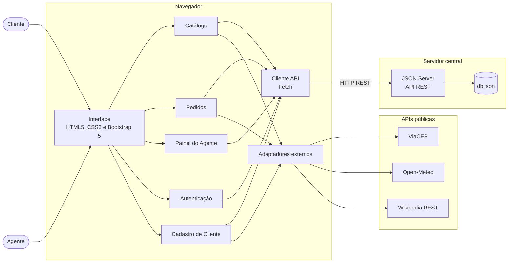
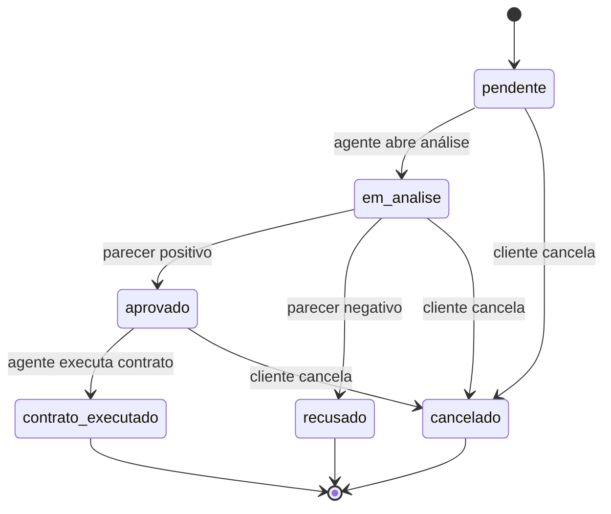

<!-- README baseado no template do Prof. Dr. João Paulo Aramuni, adaptado ao projeto WeekndCar (Laboratório 02 - DIW) -->

---

# 🚗 WeekndCar 🏁

> [!NOTE]
> Aluguel de carros clássicos e emblemáticos para o fim de semana, em Belo Horizonte: escolha o carro, reserve sábado e domingo e acompanhe o pedido até o contrato.

<table>
  <tr>
    <td width="800px">
      <div align="justify">
        O <b>WeekndCar</b> é um sistema web de apoio à gestão de aluguéis de automóveis clássicos, que permite <i>efetuar, modificar e cancelar pedidos pela Internet</i>. <b>Clientes</b> se cadastram e criam pedidos de aluguel; <b>agentes</b> (empresas e bancos) avaliam os pedidos financeiramente, executam contratos e, no caso dos bancos, concedem contratos de crédito. A interface é construída com <b>HTML5, CSS3, JavaScript e Bootstrap 5</b>, com dados persistidos em uma API REST simulada pelo <b>JSON Server</b> e consumida via <b>Fetch API</b>. Para enriquecer a experiência, o site integra APIs públicas (ViaCEP, Open-Meteo, Wikipedia e OpenStreetMap) e adota uma identidade visual retrô dos anos 60-70. Projeto desenvolvido para o <i>Laboratório 02</i> da disciplina de <b>Desenvolvimento de Interfaces Web (DIW)</b>, do curso de Engenharia de Software da PUC Minas.
      </div>
    </td>
    <td>
      <div>
        
      </div>
    </td>
  </tr>
</table>

---

## 🚧 Status do Projeto

🛠️ **Em desenvolvimento** — modelagem concluída; implementação em andamento.

      

---

## 📚 Índice
- [Links Úteis](#-links-úteis)
- [Sobre o Projeto](#-sobre-o-projeto)
- [Funcionalidades Principais](#-funcionalidades-principais)
- [Tecnologias Utilizadas](#-tecnologias-utilizadas)
- [Arquitetura](#-arquitetura)
  - [Diagramas](#diagramas)
- [Instalação e Execução](#-instalação-e-execução)
  - [Pré-requisitos](#pré-requisitos)
  - [Variáveis de Ambiente](#-variáveis-de-ambiente)
  - [Instalação de Dependências](#-instalação-de-dependências)
  - [Inicialização do Banco de Dados (JSON Server)](#-inicialização-do-banco-de-dados-json-server)
  - [Como Executar a Aplicação](#-como-executar-a-aplicação)
- [Deploy](#-deploy)
- [Estrutura de Pastas](#-estrutura-de-pastas)
- [Demonstração](#-demonstração)
  - [Aplicação Web](#-aplicação-web)
  - [Exemplo de saída no Terminal (API)](#-exemplo-de-saída-no-terminal-api)
- [Testes](#-testes)
- [Documentações utilizadas](#-documentações-utilizadas)
- [Autores](#-autores)
- [Contribuição](#-contribuição)
- [Agradecimentos](#-agradecimentos)
- [Licença](#-licença)

---

## 🔗 Links Úteis
* 🌐 **Demo Online:** _a definir (ex.: GitHub Pages ou Vercel para o front-end)_
  > 💻 **Descrição:** o front-end é estático e pode ser publicado; a API (JSON Server) roda localmente nesta etapa do laboratório.
* 📖 **Documentação:** [Modelagem UML na pasta `docs/`](./docs)
  > 📚 **Descrição:** casos de uso, histórias do usuário, diagramas de classes, pacotes e componentes.
* 📘 **Template deste README:** [template_README.md](https://github.com/joaopauloaramuni/desenvolvimento-de-interfaces-web/blob/main/TEMPLATES/template_README.md)

---

## 📝 Sobre o Projeto

**Por que existe:** o aluguel de carros clássicos costuma ser informal e concentrado em poucos locais. O WeekndCar organiza esse serviço em um fluxo digital: do catálogo ao contrato.

**Qual problema resolve:** quem quer dirigir um clássico apenas no fim de semana precisa consultar disponibilidade, enviar dados, passar por análise financeira e, às vezes, financiar o aluguel. O sistema reúne tudo isso em um único lugar, com status de pedido sempre visível.

**Contexto:** projeto acadêmico do **Laboratório 02 (15 pontos)** de DIW, com sede fictícia em **Belo Horizonte/MG**. Todos os dados (clientes, agentes, bancos e carros) são fictícios.

**Onde pode ser utilizado:** como protótipo de locadora especializada, em que clientes (pessoas físicas), empresas e bancos interagem em torno do mesmo pedido.

**Valor entregue:**
- ao **cliente**: catálogo visual, reserva só para fim de semana e acompanhamento do pedido;
- ao **agente**: lista de pedidos pendentes com os rendimentos do cliente, para decidir com segurança;
- ao **banco**: possibilidade de vincular um contrato de crédito ao aluguel aprovado.

**Regras de negócio principais** (do enunciado):
- o sistema só pode ser usado após cadastro prévio;
- clientes introduzem, modificam, consultam e cancelam pedidos; agentes modificam e avaliam pedidos;
- do contratante guardam-se RG, CPF, nome, endereço, profissão e até **3** empregadores com respectivos rendimentos;
- o automóvel registra matrícula, ano, marca, modelo e placa, e pode ser propriedade de cliente, empresa ou banco;
- o aluguel pode estar associado a um contrato de crédito concedido por um banco agente.

---

## ✨ Funcionalidades Principais

- 🔐 **Cadastro e Login:** o sistema só é usado após cadastro prévio, com perfis de cliente e agente.
- 🚘 **Catálogo de Clássicos:** muscle cars, esportivos europeus e conversíveis, com filtro por categoria e página de detalhes.
- 📅 **Pedido de Aluguel de Fim de Semana:** criação, modificação, consulta de status e cancelamento.
- 🏦 **Painel do Agente:** avaliação financeira, aprovação ou recusa, execução de contrato e concessão de crédito (bancos).
- ⚙️ **CRUD de Cliente:** cadastro com até 3 empregadores e rendimentos, persistido no JSON Server.
- 📍 **Endereço automático:** preenchimento por CEP via ViaCEP.
- ⛅ **Previsão do tempo:** previsão de sábado e domingo em Belo Horizonte (Open-Meteo) na hora de reservar.
- 📖 **História do carro:** resumo vindo da Wikipedia.
- 🗺️ **Mapa de retirada:** ponto de retirada no mapa (Leaflet com OpenStreetMap).
- 🎨 **Identidade retrô 60-70:** paleta creme, vermelho, marrom-café e mostarda, com fontes serifadas.

---

## 🛠 Tecnologias Utilizadas

As seguintes ferramentas, frameworks e bibliotecas foram utilizados na construção deste projeto.

### 💻 Front-end

* **Estrutura e lógica:** HTML5, CSS3 e JavaScript (ES Modules)
* **Interface:** Bootstrap 5.3.3
* **Estilização:** tema próprio em CSS (variáveis `--wc-*`), Google Fonts (Playfair Display e Lora) e Bootstrap Icons
* **Componentes visuais:** Swiper (carrossel) e Leaflet (mapa)
* **Consumo de dados:** Fetch API

### 🖥️ Back-end (API e persistência)

* **API REST simulada:** JSON Server 0.17.4, a partir do arquivo `db.json`
* **Banco de Dados:** arquivo JSON (coleções `clientes`, `agentes`, `carros`, `pedidos`, `contratos` e `creditos`)
* **Autenticação:** simulada no front-end, apenas para fins didáticos (senhas em texto puro no `db.json`)

### 🌐 APIs externas (sem chave de acesso)

* **ViaCEP:** endereço a partir do CEP
* **Open-Meteo:** previsão do tempo
* **Wikipedia REST:** resumos sobre os modelos de carro
* **OpenStreetMap:** mapas exibidos pelo Leaflet

### ⚙️ Infraestrutura & DevOps

* **Controle de versão:** Git e GitHub
* **Gerenciador de pacotes:** npm
* **Modelagem:** Mermaid (renderizado pelo GitHub)

---

## 🏗 Arquitetura

O sistema segue o enunciado e se divide em **dois subsistemas**:

1. **Construção dinâmica das páginas web:** pacotes `pages`, `components`, `styles` e `controllers`. Montam as telas com Bootstrap e atualizam o DOM a partir dos dados.
2. **Gestão de pedidos e contratos:** pacotes `models`, `services` e `auth`. Concentram as regras de negócio, como o fluxo de status do pedido e as validações.

A comunicação com o JSON Server fica isolada no pacote `api`, e as chamadas às APIs públicas ficam em `external`. Assim, uma falha ou troca de API externa não afeta as regras de negócio.

**Decisões importantes:**
- separar controladores, serviços e modelos para manter o **código alinhado aos diagramas**;
- manter o JSON Server como única fonte de verdade; as APIs externas apenas complementam a experiência;
- limitar os pedidos ao fim de semana, validando as datas no front-end.

**Limitações conhecidas:** autenticação simulada e sem criptografia, e API sem controle de acesso por perfil; adequado apenas ao contexto acadêmico.

### Diagramas

| Diagrama | Arquivo |
| :--- | :--- |
| Casos de uso | [docs/casos-de-uso.md](./docs/casos-de-uso.md) |
| Histórias do usuário | [docs/historias-de-usuario.md](./docs/historias-de-usuario.md) |
| Classes e ciclo de vida do pedido | [docs/diagrama-de-classes.md](./docs/diagrama-de-classes.md) |
| Pacotes (visão lógica) | [docs/diagrama-de-pacotes.md](./docs/diagrama-de-pacotes.md) |
| Componentes | [docs/diagrama-de-componentes.md](./docs/diagrama-de-componentes.md) |

**Visão geral dos componentes:**



**Ciclo de vida do pedido:**



---

## 🔧 Instalação e Execução

### Pré-requisitos

* **Node.js:** versão LTS (v18.x ou superior), necessária para o **JSON Server**
* **Gerenciador de Pacotes:** npm (já incluso no Node.js)
* **Git:** para clonar o repositório
* **Servidor estático:** extensão **Live Server** do VS Code ou o pacote `serve`, porque os módulos JavaScript (ES Modules) não funcionam abrindo o HTML direto pelo arquivo
* **Docker:** não é necessário neste projeto

---

### 🔑 Variáveis de Ambiente

Este projeto **não usa arquivos `.env`** nem chaves secretas: ViaCEP, Open-Meteo, Wikipedia e OpenStreetMap são APIs públicas e gratuitas.

A única configuração é a URL base da API, definida em `assets/js/api/api-client.js`:

| Constante | Descrição | Valor padrão |
| :--- | :--- | :--- |
| `BASE_URL` | URL base do JSON Server | `http://localhost:3000` |

---

### 📦 Instalação de Dependências

1. **Clone o repositório:**

```bash
git clone <URL_DO_SEU_REPOSITÓRIO>
cd weekndcar
```

2. **Instale as dependências (apenas o JSON Server):**

```bash
npm install
```

O Bootstrap, as fontes e as bibliotecas de interface são carregados por CDN, sem instalação.

---

### 💾 Inicialização do Banco de Dados (JSON Server)

O "banco de dados" é o arquivo **`db.json`**, na raiz do projeto, já com dados fictícios:

| Coleção | Conteúdo inicial |
| :--- | :--- |
| `clientes` | 2 clientes, com RG, CPF, endereço, profissão e rendimentos |
| `agentes` | 2 empresas e 3 bancos |
| `carros` | 12 carros: 4 muscle cars, 4 europeus e 4 conversíveis |
| `pedidos` | 2 pedidos de exemplo (um pendente e um com contrato executado) |
| `contratos` | 1 contrato |
| `creditos` | 1 contrato de crédito |

Não há migrações: o JSON Server lê e grava diretamente o `db.json`. Para restaurar os dados originais, use `git checkout db.json`.

---

### ⚡ Como Executar a Aplicação
Execute em **dois terminais separados**.

#### Terminal 1: API (JSON Server)

```bash
npm run api
```
🚀 *A API estará disponível em **http://localhost:3000**.*

#### Terminal 2: Front-end

```bash
npx serve .
```
🎨 *O site estará disponível na porta indicada pelo `serve` (normalmente **http://localhost:3000**; se estiver ocupada, ele sugere outra). Com o Live Server do VS Code, clique em **Go Live** no `index.html`.*

> [!NOTE]
> A porta 3000 é usada pelo JSON Server. Se o `serve` escolher outra porta, nada muda na configuração, pois o front-end só precisa alcançar `http://localhost:3000`.

#### Usuários de teste

Dados fictícios, com autenticação apenas simulada.

| Perfil | E-mail | Senha |
| :--- | :--- | :--- |
| Cliente | marina@email.com | 123456 |
| Cliente | rafael@email.com | 123456 |
| Agente (empresa) | savassi@weekndcar.com | 123456 |
| Agente (banco) | credito@bancomineirao.com | 123456 |

---

## 🚀 Deploy

Nesta etapa do laboratório, o sistema roda localmente. Para publicar:

1. **Front-end:** por ser estático, pode ser publicado no **GitHub Pages**, Vercel ou Netlify, sem etapa de build.
2. **API:** o JSON Server precisa de um servidor Node.js (por exemplo, Render ou Railway). Depois de publicar, altere a constante `BASE_URL` em `assets/js/api/api-client.js` para a URL da API.

> [!IMPORTANT]
> Não publique dados reais: o `db.json` guarda senhas em texto puro e o JSON Server não controla acesso por perfil.

---

## 📂 Estrutura de Pastas

```
.
├── .gitignore                   # 🧹 Ignora node_modules e arquivos do sistema.
├── README.md                    # 📘 Documentação principal do projeto.
├── package.json                 # 📦 Dependências e script `npm run api`.
├── db.json                      # 💾 Banco de dados do JSON Server (dados fictícios).
├── index.html                   # 🏠 Página inicial com o catálogo.
│
├── /pages                       # 📄 Demais telas (login, cadastro, pedidos, painel do agente).
│
├── /assets                      # 🖼️ Recursos do front-end
│   ├── /css                     # 🎨 Tema retrô 60-70 (theme.css).
│   ├── /img                     # 🖼️ Logo e fotos do catálogo.
│   │   └── /carros              # 🚘 Fotos dos carros (nomes definidos no db.json).
│   └── /js                      # ⚙️ Código JavaScript (ES Modules)
│       ├── /api                 # 🔌 Cliente Fetch do JSON Server.
│       ├── /auth                # 🛡️ Login simulado e controle por perfil.
│       ├── /components          # 🧱 Componentes reutilizáveis (navbar, cards, carrossel, mapa).
│       ├── /controllers         # 🎮 Eventos e renderização das telas.
│       ├── /models              # 🧬 Classes de domínio (alinhadas ao diagrama de classes).
│       ├── /services            # ⚙️ Regras de negócio (pedidos e contratos).
│       └── /external            # 🌐 Adaptadores de ViaCEP, Open-Meteo e Wikipedia.
│
└── /docs                        # 📚 Modelagem UML (casos de uso, histórias, classes, pacotes e componentes).
```

---

## 🎥 Demonstração

> [!WARNING]
> Prints e GIFs ainda não foram adicionados. Substitua os espaços reservados abaixo por imagens hospedadas na pasta `docs/img/` ou no GitHub Pages.

### 🌐 Aplicação Web

| Tela | Captura de Tela |
| :---: | :---: |
| **Página Inicial (Catálogo)** | **Detalhe do Carro** |
| _Print aqui_ | _Print aqui_ |
| **Cadastro de Cliente** | **Login** |
| _Print aqui_ | _Print aqui_ |
| **Novo Pedido (com previsão do tempo)** | **Meus Pedidos (status)** |
| _Print aqui_ | _Print aqui_ |
| **Painel do Agente** | **Mapa de Retirada** |
| _Print aqui_ | _Print aqui_ |

### 💻 Exemplo de Saída no Terminal (API)

#### 1. Inicialização da API

```bash
npm run api
```

**Saída esperada (aproximada):**
```text
  \{^_^}/ hi!

  Loading db.json
  Done

  Resources
  http://localhost:3000/clientes
  http://localhost:3000/agentes
  http://localhost:3000/carros
  http://localhost:3000/pedidos
  http://localhost:3000/contratos
  http://localhost:3000/creditos

  Home
  http://localhost:3000
```

#### 2. Consulta de um pedido (exemplo com cURL)

```bash
curl -X GET 'http://localhost:3000/pedidos/1'
```

**Saída Esperada:**
```json
{
  "id": 1,
  "clienteId": 1,
  "carroId": 9,
  "dataRetirada": "2026-11-07",
  "dataDevolucao": "2026-11-08",
  "valorTotal": 3400,
  "status": "pendente",
  "criadoEm": "2026-11-02T10:00:00-03:00"
}
```

#### 3. Filtros úteis do JSON Server

```bash
# Carros de uma categoria
curl 'http://localhost:3000/carros?categoria=conversivel'

# Pedidos de um cliente
curl 'http://localhost:3000/pedidos?clienteId=1'

# Pedidos aguardando avaliação
curl 'http://localhost:3000/pedidos?status=pendente'
```

---

## 🧪 Testes

Ainda não há testes automatizados. Nesta etapa, a validação é manual, seguindo as histórias do usuário em [`docs/historias-de-usuario.md`](./docs/historias-de-usuario.md):

- [ ] Catálogo carrega do JSON Server e filtra por categoria
- [ ] Cadastro de cliente preenche o endereço pelo CEP
- [ ] Login libera as telas conforme o perfil
- [ ] Cliente cria, modifica e cancela pedido
- [ ] Datas aceitam apenas sábado e domingo
- [ ] Agente aprova ou recusa pedidos e executa contrato
- [ ] Banco vincula contrato de crédito

Evolução prevista: testes unitários das regras de status com **Vitest** ou **Jest**.

---

## 🔗 Documentações utilizadas

* 📖 **Interface:** [Bootstrap 5 – Documentação](https://getbootstrap.com/docs/5.3/getting-started/introduction/)
* 📖 **API e persistência:** [JSON Server – Repositório e documentação](https://github.com/typicode/json-server/tree/v0.17.4)
* 📖 **Requisições HTTP:** [Fetch API (MDN)](https://developer.mozilla.org/pt-BR/docs/Web/API/Fetch_API)
* 📖 **CEP:** [ViaCEP](https://viacep.com.br/)
* 📖 **Previsão do tempo:** [Open-Meteo](https://open-meteo.com/en/docs)
* 📖 **Resumos de carros:** [Wikipedia REST API](https://en.wikipedia.org/api/rest_v1/)
* 📖 **Mapas:** [Leaflet](https://leafletjs.com/reference.html)
* 📖 **Carrossel:** [Swiper](https://swiperjs.com/swiper-api)
* 📖 **Diagramas:** [Mermaid](https://mermaid.js.org/intro/)
* 📖 **Guia de Estilo:** [Conventional Commits](https://www.conventionalcommits.org/en/v1.0.0/)
* 📖 **Documentação Interna:** [Modelagem UML](./docs)

---

## 👥 Autores

| 👤 Nome | :octocat: GitHub | 💼 LinkedIn | 📤 E-mail |
|---------|-----------------|-------------|-----------|
| Gabriel | [@seu-usuario](https://github.com/seu-usuario) | [seu-perfil](https://www.linkedin.com/in/seu-perfil) | seu-email@exemplo.com |

> [!TIP]
> 💡 **Dica:** substitua os dados acima pelos seus e inclua os demais integrantes do grupo, se houver.

---

## 🤝 Contribuição

1. Faça um `fork` do projeto.
2. Crie uma branch para sua feature (`git checkout -b feature/minha-feature`).
3. Faça o commit das mudanças (`git commit -m 'feat: adiciona nova funcionalidade X'`), seguindo o padrão [Conventional Commits](https://www.conventionalcommits.org/en/v1.0.0/).
4. Faça o `push` para a branch (`git push origin feature/minha-feature`).
5. Abra um **Pull Request (PR)**.

---

## 🙏 Agradecimentos

* [**Engenharia de Software PUC Minas**](https://www.instagram.com/engsoftwarepucminas/) - Pelo apoio institucional e estrutura acadêmica.
* [**Prof. Dr. João Paulo Aramuni**](https://github.com/joaopauloaramuni) - Pelo enunciado, pelo template de documentação e pelos ensinamentos em **Desenvolvimento de Interfaces Web**.

---

## 📄 Licença

Este projeto é distribuído sob a **Licença MIT**. Adicione um arquivo `LICENSE` na raiz do repositório com o texto da licença.

---
