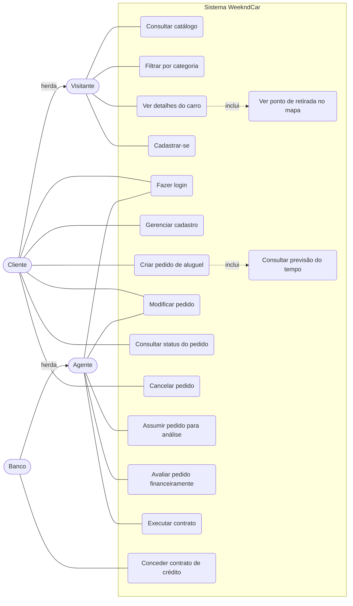

# Diagrama de Casos de Uso — WeekndCar

Sistema de aluguel de carros clássicos e emblemáticos para o fim de semana, com sede em Belo Horizonte.

## Atores

| Ator | Descrição |
|------|-----------|
| Visitante | Usuário sem cadastro; consulta o catálogo e pode se cadastrar |
| Cliente | Usuário cadastrado que cria e acompanha pedidos de aluguel (herda os casos de uso do Visitante) |
| Agente | Empresa ou banco que assume, avalia e modifica pedidos e executa contratos |
| Banco | Especialização de Agente; também concede contratos de crédito |

## Diagrama

## Descrição resumida

| Caso de uso | Ator | Pré-condição | Resultado |
|-------------|------|--------------|-----------|
| Consultar catálogo, filtrar e ver detalhes | Visitante | — | Lista de carros (filtro por categoria) e página do carro com resumo da Wikipedia |
| Ver ponto de retirada no mapa | Visitante | Estar na página do carro | Mapa com o ponto de retirada e link "Como chegar" |
| Cadastrar-se | Visitante | — | Cliente criado no JSON Server (endereço via ViaCEP; CPF e e-mail únicos) |
| Fazer login | Cliente, Agente | Cadastro existente | Sessão iniciada; cliente vai ao catálogo e agente ao painel |
| Gerenciar cadastro | Cliente | Logado | Consulta, alteração e exclusão; a exclusão é bloqueada se houver pedidos ativos |
| Criar pedido de aluguel | Cliente | Logado; carro livre no fim de semana | Pedido `pendente`, 2 diárias, com histórico |
| Consultar previsão do tempo | Cliente | Fim de semana escolhido | Previsão de sábado e domingo (Open-Meteo), para os próximos 16 dias |
| Modificar pedido | Cliente | Pedido `pendente` ou `em análise` | Fim de semana alterado |
| Modificar pedido | Agente | Pedido `em análise` sob sua responsabilidade | Fim de semana e valor total alterados |
| Consultar status do pedido | Cliente | Logado | Lista com status, histórico e pareceres |
| Cancelar pedido | Cliente | Pedido `pendente`, `em análise` ou `aprovado` | Status `cancelado` |
| Assumir pedido para análise | Agente | Pedido `pendente`, sem agente | Pedido `em análise`, com o agente responsável |
| Avaliar pedido financeiramente | Agente | Pedido `em análise` sob sua responsabilidade | Status `aprovado` ou `recusado`, com parecer opcional |
| Executar contrato | Agente | Pedido `aprovado` sob sua responsabilidade | Contrato criado e status `contrato executado` |
| Conceder contrato de crédito | Banco | Contrato executado, ainda sem crédito | Contrato de crédito vinculado ao contrato |
