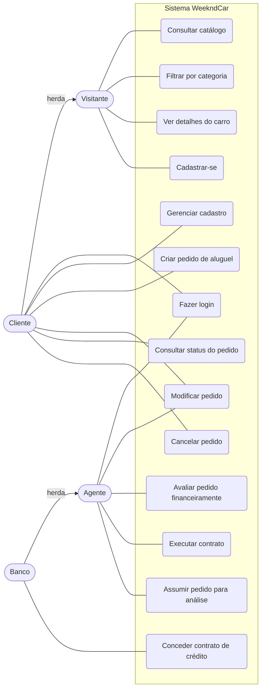

# Diagrama de Casos de Uso — WeekndCar

Sistema de aluguel de carros clássicos e emblemáticos para o fim de semana, com sede em Belo Horizonte.

## Atores

| Ator | Descrição |
|------|-----------|
| Visitante | Usuário sem cadastro; só consulta o catálogo e pode se cadastrar |
| Cliente | Usuário cadastrado que cria e acompanha pedidos de aluguel |
| Agente | Empresa ou banco que avalia e modifica pedidos |
| Banco | Especialização de Agente; também concede contratos de crédito |

## Diagrama

## Descrição resumida

| Caso de uso | Ator | Pré-condição | Resultado |
|-------------|------|--------------|-----------|
| Cadastrar-se | Visitante | — | Cliente criado no JSON Server (endereço via ViaCEP) |
| Fazer login | Cliente, Agente | Cadastro existente | Sessão iniciada |
| Criar pedido de aluguel | Cliente | Logado | Pedido com status `pendente` |
| Modificar pedido | Cliente, Agente | Pedido não contratado | Pedido atualizado |
| Cancelar pedido | Cliente | Pedido sem contrato executado | Status `cancelado` |
| Assumir pedido para análise | Agente | Pedido `pendente`, sem agente | Pedido `em análise`, com o agente responsável |
| Avaliar pedido financeiramente | Agente | Pedido `em análise` sob sua responsabilidade | Status `aprovado` ou `recusado`, com parecer opcional |
| Executar contrato | Agente | Pedido `aprovado` sob sua responsabilidade | Contrato criado, status `contrato executado` |
| Conceder contrato de crédito | Banco | Contrato executado, ainda sem crédito | Contrato de crédito vinculado ao contrato |
