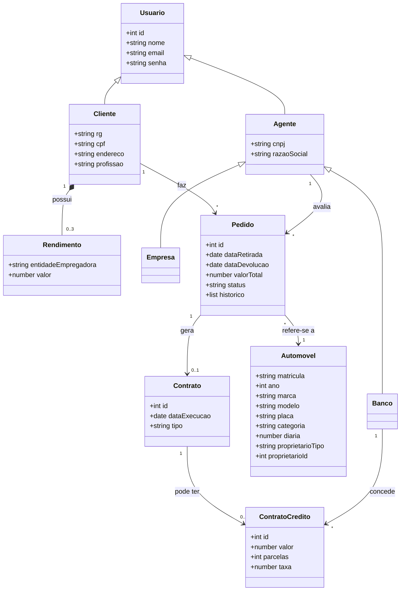
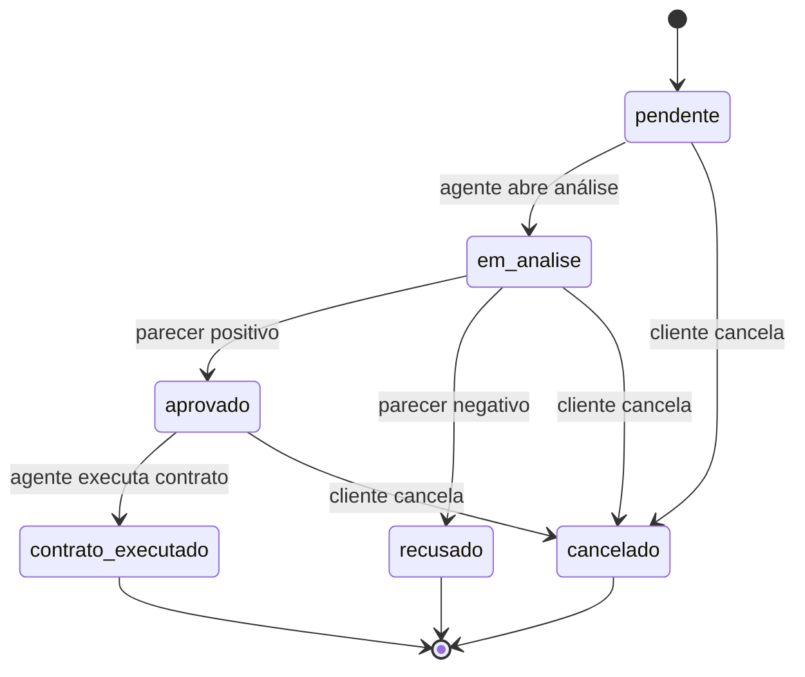

# Diagrama de Classes — WeekndCar

## Classes e relacionamentos

## Ciclo de vida do pedido

## Mapeamento para o `db.json`

| Classe | Coleção no JSON Server |
|--------|------------------------|
| Cliente (com `rendimentos` embutidos, máx. 3) | `clientes` |
| Empresa e Banco | `agentes` (campo `tipo`) |
| Automovel | `carros` |
| Pedido | `pedidos` |
| Contrato | `contratos` |
| ContratoCredito | `creditos` |

## Observação sobre chaves estrangeiras

Não grave chaves estrangeiras nulas no `db.json` (por exemplo, `"agenteId": null`). O JSON Server 0.17 interpreta qualquer campo terminado em `Id` como relação e retorna erro 500 em qualquer `DELETE` quando encontra um valor nulo. Omita o campo no pedido e preencha-o somente quando um agente assumir a avaliação.

## Regras do pedido

- O pedido só pode ser feito para um fim de semana: retirada no sábado e devolução no domingo seguinte, sempre depois de hoje. O valor é de 2 diárias.
- Um carro não pode ter dois pedidos ativos (pendente, em análise, aprovado ou contrato executado) no mesmo fim de semana.
- O cliente pode alterar o fim de semana enquanto o pedido estiver pendente ou em análise.
- O cliente pode cancelar enquanto o pedido estiver pendente, em análise ou aprovado.
- Cada mudança de status é registrada no campo `historico`, com data e hora.

## Regras do agente

- Qualquer agente vê os pedidos pendentes. Ao assumir um pedido, o campo `agenteId` passa a existir e só esse agente pode avaliá-lo, modificá-lo e executar o contrato.
- O agente pode modificar o fim de semana e o valor total enquanto o pedido estiver em análise.
- A avaliação aceita um parecer opcional, que aparece no histórico e é visto pelo cliente.
- O crédito é concedido por um banco sobre um contrato já executado, com valor, parcelas e taxa em % ao mês. O contrato passa a ser do tipo "aluguel com crédito".
