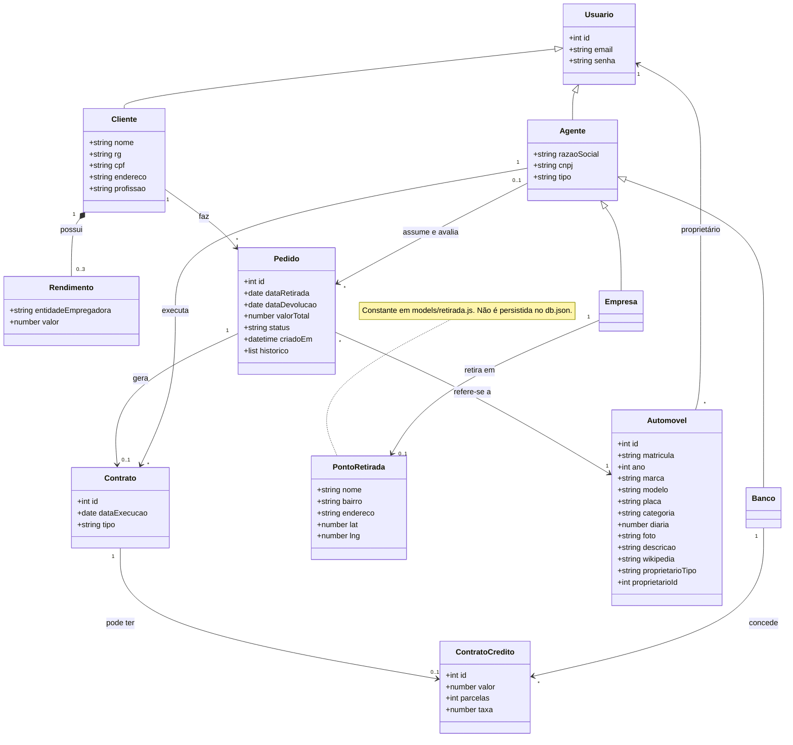
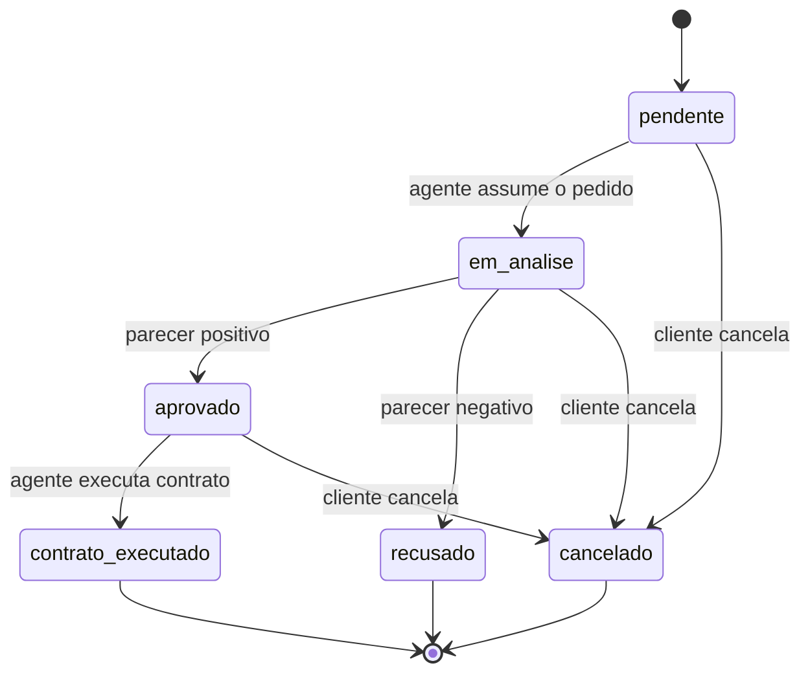

# Diagrama de Classes — WeekndCar

## Classes e relacionamentos

## Ciclo de vida do pedido

## Como as classes aparecem no código

O código não usa classes ES6. Cada classe do modelo é um objeto JSON guardado no JSON Server, e as regras vivem em módulos de `assets/js/models/` e `assets/js/services/`.

| Classe | Coleção no JSON Server | Módulos |
|--------|------------------------|---------|
| Usuario, Cliente, Rendimento | `clientes` (com `rendimentos` embutidos, máx. 3) | `models/cliente.js`, `services/cliente-service.js` |
| Agente, Empresa, Banco | `agentes` (campo `tipo`: `empresa` ou `banco`) | `services/agente-service.js` |
| Automovel | `carros` | `models/carro.js`, `services/carro-service.js` |
| Pedido | `pedidos` | `models/pedido.js`, `services/pedido-service.js` |
| Contrato | `contratos` | `services/contrato-service.js` |
| ContratoCredito | `creditos` | `models/credito.js`, `services/contrato-service.js` |
| PontoRetirada | não persistida | `models/retirada.js` |

Observações sobre o modelo:
- `Usuario` guarda só o que cliente e agente têm em comum. O nome do cliente fica em `Cliente.nome` e o do agente em `Agente.razaoSocial`.
- O proprietário do automóvel (cliente, empresa ou banco) fica no próprio `Automovel`, nos campos `proprietarioTipo` e `proprietarioId`. O `Contrato.tipo` indica apenas se o aluguel é simples ou com crédito (`aluguel` ou `aluguel com crédito`). Essa foi a interpretação adotada para o requisito do enunciado sobre a propriedade dos automóveis.
- Em `Contrato` e `ContratoCredito`, as chaves estrangeiras são `pedidoId`, `agenteId`, `contratoId` e `bancoId`.

## Regras do pedido

- O pedido só pode ser feito para um fim de semana: retirada no sábado e devolução no domingo seguinte, sempre depois de hoje. O valor é de 2 diárias.
- Um carro não pode ter dois pedidos ativos (pendente, em análise, aprovado ou contrato executado) no mesmo fim de semana.
- O cliente pode alterar o fim de semana enquanto o pedido estiver pendente ou em análise.
- O cliente pode cancelar enquanto o pedido estiver pendente, em análise ou aprovado.
- Cada mudança de status é registrada no campo `historico`, com data, hora e uma nota opcional (o parecer do agente, por exemplo).
- O cliente só pode excluir o cadastro se não tiver pedidos ativos. Os pedidos cancelados ou recusados são apagados junto.

## Regras do agente

- Qualquer agente vê os pedidos pendentes. Ao assumir um pedido, o campo `agenteId` passa a existir e só esse agente pode avaliá-lo, modificá-lo e executar o contrato.
- O agente pode modificar o fim de semana e o valor total enquanto o pedido estiver em análise.
- A avaliação aceita um parecer opcional, que aparece no histórico e é visto pelo cliente.
- O crédito é concedido por um banco sobre um contrato já executado, com valor, parcelas e taxa em % ao mês. O contrato passa a ser do tipo "aluguel com crédito".

## Observação sobre chaves estrangeiras nulas

Não grave chaves estrangeiras nulas no `db.json` (por exemplo, `"agenteId": null`). O JSON Server 0.17 interpreta qualquer campo terminado em `Id` como relação e retorna erro 500 em qualquer `DELETE` quando encontra um valor nulo. Por isso o pedido nasce sem `agenteId`, e o campo só é criado quando um agente assume a análise.
