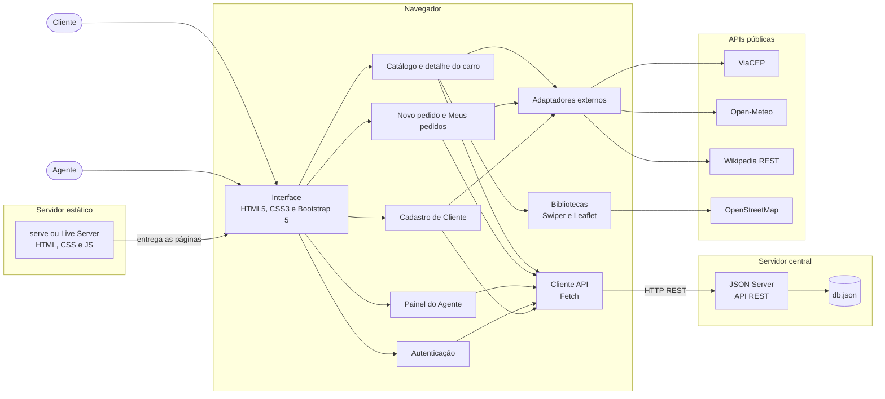

# Diagrama de Componentes — WeekndCar

Visão de execução: o navegador do cliente ou do agente recebe as páginas de um servidor estático e consome, via Fetch API, o servidor central (JSON Server) e algumas APIs públicas.

## Diagrama



O link "Como chegar" da página do carro apenas abre o Google Maps em outra aba, sem chamada de API.

## Componentes e interfaces

| Componente | Interface fornecida | Interface requerida |
|------------|---------------------|---------------------|
| Catálogo e detalhe do carro | Listar e filtrar carros, carrossel de destaques, detalhe, resumo do modelo e mapa de retirada | Cliente API (`/carros`, `/agentes`), Wikipedia, Swiper, Leaflet e OpenStreetMap |
| Autenticação | Login e logout, perfil da sessão | Cliente API (`/clientes`, `/agentes`) |
| Cadastro de Cliente | CRUD de cliente | Cliente API (`/clientes`, `/pedidos`), ViaCEP |
| Novo pedido e Meus pedidos | Criar, alterar, consultar e cancelar pedido; histórico | Cliente API (`/pedidos`, `/carros`), Open-Meteo |
| Painel do Agente | Assumir e avaliar pedido, modificar, executar contrato e conceder crédito | Cliente API (`/pedidos`, `/carros`, `/clientes`, `/agentes`, `/contratos`, `/creditos`) |
| Cliente API | Funções GET, POST, PATCH e DELETE | JSON Server |
| JSON Server | API REST sobre o `db.json` | Arquivo `db.json` |
| Servidor estático | Entrega de HTML, CSS e JS | Pasta do projeto e `serve.json` |

## Endpoints do JSON Server

| Rota | Uso |
|------|-----|
| `/clientes` | CRUD de cliente |
| `/agentes` | Empresas e bancos (campo `tipo`) |
| `/carros` | Catálogo |
| `/pedidos` | Pedidos de aluguel |
| `/contratos` | Contratos executados |
| `/creditos` | Contratos de crédito concedidos por bancos |

## Como executar

Em dois terminais, na raiz do projeto:

```bash
npm install
npm run api      # JSON Server 0.17.4 em http://localhost:3000
npx serve .      # servidor estático (usa o serve.json da raiz)
```
