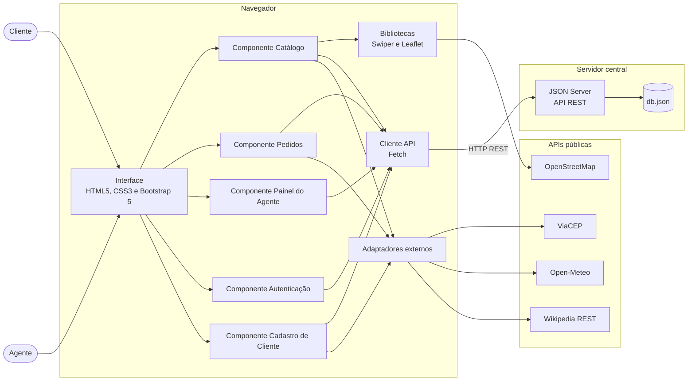

# Diagrama de Componentes — WeekndCar

Visão de execução: o navegador do cliente ou do agente consome, via Fetch API, um servidor central (JSON Server) e algumas APIs públicas.

## Diagrama

## Componentes e interfaces

| Componente | Interface fornecida | Interface requerida |
|------------|---------------------|---------------------|
| Catálogo | Listar e filtrar carros, detalhe do carro | Cliente API (`/carros`), Wikipedia, Swiper |
| Autenticação | Login e logout, perfil da sessão | Cliente API (`/clientes`, `/agentes`) |
| Cadastro de Cliente | CRUD de cliente | Cliente API (`/clientes`), ViaCEP |
| Pedidos | Criar, modificar, consultar e cancelar pedido | Cliente API (`/pedidos`), Open-Meteo |
| Painel do Agente | Avaliar pedido, executar contrato, conceder crédito | Cliente API (`/pedidos`, `/contratos`, `/creditos`) |
| Cliente API | Funções GET, POST, PATCH e DELETE | JSON Server |
| JSON Server | API REST sobre o `db.json` | Arquivo `db.json` |

## Endpoints do JSON Server

| Rota | Uso |
|------|-----|
| `/clientes` | CRUD de cliente |
| `/agentes` | Empresas e bancos (campo `tipo`) |
| `/carros` | Catálogo |
| `/pedidos` | Pedidos de aluguel |
| `/contratos` | Contratos executados |
| `/creditos` | Contratos de crédito concedidos por bancos |

Para executar o servidor: `npm install` e depois `npm run api` (JSON Server 0.17.4 em `http://localhost:3000`).
