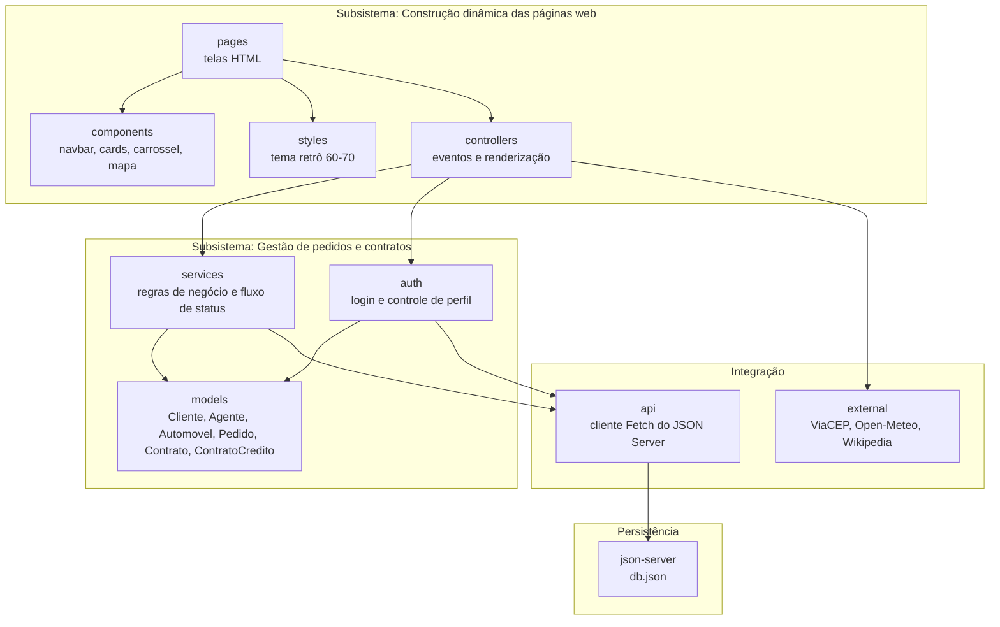

# Diagrama de Pacotes (Visão Lógica) — WeekndCar

O enunciado divide o sistema em dois subsistemas: **gestão de pedidos e contratos** e **construção dinâmica das páginas web**. Os pacotes abaixo seguem essa divisão e adicionam os pacotes de integração externa e de persistência.

## Diagrama



## Responsabilidade de cada pacote

| Pacote | Responsabilidade |
|--------|------------------|
| `pages` | Telas: catálogo, detalhe do carro, login, cadastro, meus pedidos, painel do agente |
| `components` | Partes reutilizáveis da interface, montadas com Bootstrap 5, Swiper e Leaflet |
| `styles` | Variáveis CSS da identidade visual (creme, vermelho, marrom-café, mostarda) |
| `controllers` | Ligam a interface às regras: capturam eventos e atualizam o DOM |
| `models` | Classes de domínio, alinhadas ao diagrama de classes |
| `services` | Regras do pedido (transições de status, validações) e do contrato |
| `auth` | Login simulado e bloqueio de telas por perfil (cliente ou agente) |
| `api` | Funções Fetch genéricas (GET, POST, PATCH, DELETE) para o JSON Server |
| `external` | Chamadas às APIs externas, isoladas para facilitar troca ou falha |
| `json-server` | `db.json` com as coleções `clientes`, `agentes`, `carros`, `pedidos`, `contratos` e `creditos` |

## Mapa para a estrutura de pastas

Mantém o código alinhado ao modelo, que é um dos critérios de avaliação.

```text
weekndcar/
├── db.json
├── index.html
├── docs/
├── pages/
├── assets/
│   ├── css/            # styles
│   ├── img/
│   └── js/
│       ├── components/
│       ├── controllers/
│       ├── models/
│       ├── services/
│       ├── auth/
│       ├── api/
│       └── external/
└── README.md
```
