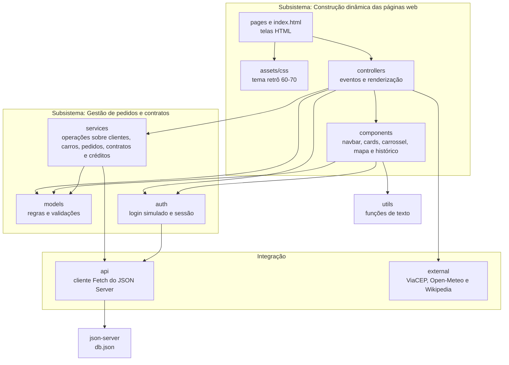

# Diagrama de Pacotes (Visão Lógica) — WeekndCar

O enunciado divide o sistema em dois subsistemas: **gestão de pedidos e contratos** e **construção dinâmica das páginas web**. Os pacotes abaixo seguem essa divisão e acrescentam os pacotes de integração, de utilitários e a persistência. As setas mostram as dependências reais de importação do código (`import` entre as pastas de `assets/js`).

## Diagrama



Não há dependências circulares: `models` e `utils` não dependem de nenhum outro pacote do sistema, e `controllers` é o único pacote que conhece todos os demais.

## Responsabilidade de cada pacote

| Pacote | Responsabilidade |
|--------|------------------|
| `pages` e `index.html` | Telas: catálogo, detalhe do carro, login, cadastro, novo pedido, meus pedidos e painel do agente |
| `assets/css` | Variáveis CSS da identidade visual (creme, vermelho, marrom-café, mostarda) e estilos das telas |
| `controllers` | Ligam a interface às regras: capturam eventos, chamam os serviços e atualizam o DOM |
| `components` | Partes reutilizáveis da interface: barra de navegação, cards, carrossel (Swiper), mapa (Leaflet), histórico e utilitários de DOM |
| `models` | Regras e validações de domínio: CPF, status do pedido, fins de semana, crédito, categorias e pontos de retirada |
| `services` | Operações sobre as coleções (CRUD e regras de fluxo): clientes, carros, pedidos, contratos, créditos e agentes |
| `auth` | Login simulado, sessão no navegador e bloqueio de telas por perfil (cliente ou agente) |
| `api` | Funções Fetch genéricas (GET, POST, PATCH e DELETE) para o JSON Server |
| `external` | Chamadas às APIs públicas, isoladas para facilitar troca ou falha |
| `utils` | Funções de texto sem dependências, como a que escapa HTML |
| `json-server` | `db.json` com as coleções `clientes`, `agentes`, `carros`, `pedidos`, `contratos` e `creditos` |

## Mapa para a estrutura de pastas

Mantém o código alinhado ao modelo, que é um dos critérios de avaliação.

```text
weekndcar/
├── db.json
├── index.html
├── serve.json            # configuração do servidor estático
├── package.json
├── LICENSE
├── README.md
├── docs/                 # modelagem UML
├── pages/                # demais telas HTML
└── assets/
    ├── css/              # styles
    ├── img/
    └── js/
        ├── controllers/
        ├── components/
        ├── models/
        ├── services/
        ├── auth/
        ├── api/
        ├── external/
        └── utils/
```
